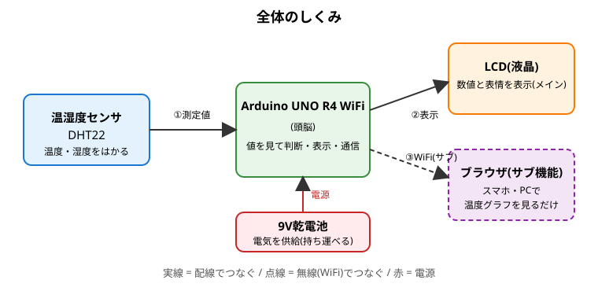
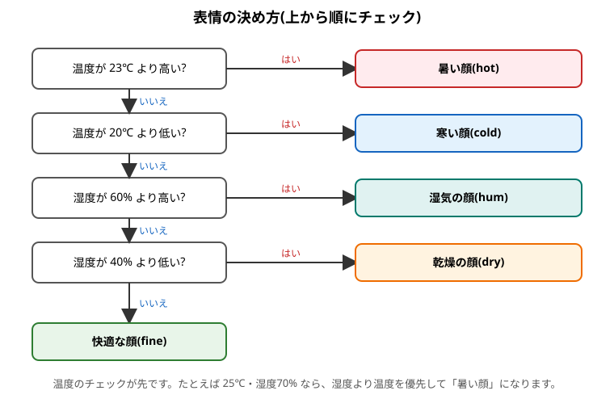
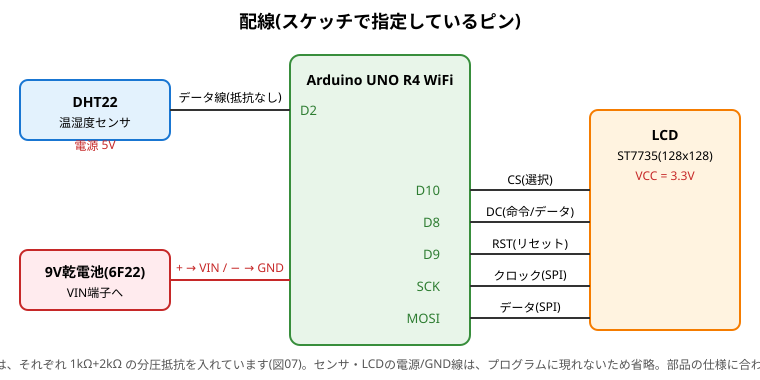
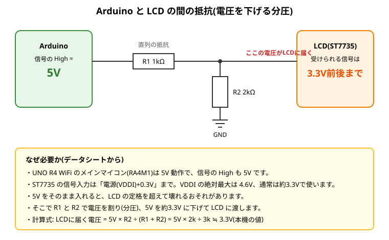

# 見守りわらびーちゃん

キャラクター「わらび」の表情で、床近くの赤ちゃんの快適な温湿度をひと目で確認できる温湿度計です。
Arduino UNO R4 WiFi で作りました。9V 乾電池だけで動作します。

Physical AI チャレンジ 2026(Sponsored by Arduino)応募作品です。 #ArduinoAIチャレンジ

- ProtoPedia: <!-- TODO: 作品ページのURL -->

## 動作

DHT22 で温度・湿度を2秒ごとに測り、上から順に判定して LCD に表情を出します。

| 順 | 条件 | 表情 |
|---|---|---|
| 1 | 温度 > 23℃ | 暑い |
| 2 | 温度 < 20℃ | 寒い |
| 3 | 湿度 > 60% | 湿気 |
| 4 | 湿度 < 40% | 乾燥 |
| 5 | 上記以外 | 快適 |

WiFi 接続すると、同じネットワークのブラウザで温度グラフも見られます(サブ機能)。
現バージョンはルールベースで、AI は使っていません。

## 部品・配線

Arduino UNO R4 WiFi、DHT22(AM2302)モジュール、1.44インチ ST7735 128x128 SPI LCD、9V 電池(VIN に接続)、抵抗 1kΩ・2kΩ 各5本。

| 信号 | ピン |
|---|---|
| DHT22 データ | D2(電源 5V) |
| LCD CS / DC / RST | D10 / D8 / D9 |
| LCD SCK / MOSI | SCK / MOSI(電源 3.3V) |

Arduino(5V)から LCD(3.3V 系)へ向かう5本の信号線には、1kΩ(直列)+2kΩ(GND へ)の分圧抵抗を入れています。
使う LCD モジュールに電圧変換が付いているか、仕様を確認してください。

## 使い方

1. Arduino IDE にライブラリを入れます: Adafruit GFX、Adafruit ST7735、DHT sensor library(WiFiS3 は UNO R4 のボードパッケージに含まれます)。
2. `LCD_Tmeter/arduino_secrets.example.h` を `arduino_secrets.h` という名前でコピーし、自分の WiFi の SSID とパスワードに書き換えます。
   **`arduino_secrets.h` は公開しないでください**(`.gitignore` で除外済みです)。
3. `LCD_Tmeter/LCD_Tmeter.ino` を開き、UNO R4 WiFi に書き込みます。
4. グラフは、シリアルモニタに表示される IP アドレスをブラウザで開くと見られます(Chart.js を CDN から読むため、インターネット接続が必要です)。

表情の画像(`LCD_Tmeter/*.h`)は、70x70 の PNG を RGB565 の配列に変換したものです。
